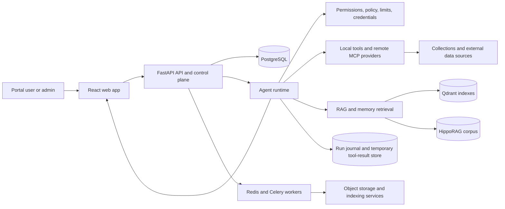

# ML Portal Architecture Map

This document is the orientation layer for engineers and coding agents. It explains the system boundaries and points to the documents that own detailed contracts. It is not a replacement for those contracts.

## How to use this map

Start here when you need to understand the whole platform or assess a cross-domain change. Then read only the domain documents relevant to the task. Treat the running code and persisted contracts as the evidence for current behavior; when they disagree with documentation, report the discrepancy and update the owning document as part of a behavior change.

The platform overview describes product domains and user roles. This map describes technical boundaries and the documentation structure. Detailed schemas, lifecycle rules, and protocols live in their linked architecture documents.

## System at a glance

ML Portal is a web application for configuring and running enterprise AI workflows. A workflow combines an agent and its published configuration with operations/tools, data collections, policy, permissions, credentials, and runtime limits.

The diagram is a responsibility map, not an exhaustive deployment topology. The compose files and deployment documentation define which services run in each environment.

## Repository boundaries

| Area | Responsibility | Start with |
| --- | --- | --- |
| `apps/web/src/` | React/TypeScript portal, routed pages, domain UI, shared components and API clients | [Frontend rules](../frontend/RULES.md), [frontend patterns](../frontend/PATTERNS.md) |
| `apps/api/src/app/api/` | HTTP contracts, request validation, dependencies, authentication and error mapping | [Backend rules](../backend/RULES.md), [authentication](AUTHENTICATION.md) |
| `apps/api/src/app/services/` | Business logic, orchestration, transaction ownership and application workflows | [Backend patterns](../backend/PATTERNS.md) |
| `apps/api/src/app/repositories/` | Database query and persistence access; repositories do not commit | [Backend rules](../backend/RULES.md) |
| `apps/api/src/app/runtime/` and `agents/` | Turn routing, planning, task orchestration, operation execution, memory/context, events and pause/resume | [Agent Runtime](AGENT_RUNTIME.md), [TurnPreflight ADR](ADR_TURN_PREFLIGHT_ROUTING.md) |
| `apps/api/src/app/workers/` | Background ingestion, indexing, memory and maintenance jobs | [Platform overview](../PLATFORM_OVERVIEW.md), relevant domain contract |
| `mcp/` | MCP providers and integrations; providers expose capabilities, while runtime resolves access and execution targets | [Flows](FLOWS.md), [MCP credential flow](MCP_CREDENTIAL_FLOW.md) |
| `infra/`, compose files and `scripts/` | Local and deployed infrastructure, service wiring and operational tooling | [Admin docs](../admin/README.md) |
| `apps/api/tests/`, `apps/web/` tests | Unit, integration, evaluation and browser-level evidence | [Testing guide](../TESTING.md) |

These boundaries describe where responsibilities belong; they do not claim every feature has a perfectly isolated implementation. Follow existing domain patterns and identify the canonical owner before moving logic.

## Main domain boundaries

### Chat and agent runtime

Chat is the user-facing execution surface. The API validates a turn and its attachments, then the runtime prepares context and routes the turn before planning or direct synthesis. The planner proposes work; orchestration owns persisted task lifecycle and execution; agents execute assigned tasks through resolved operations; synthesis produces the user-facing result. Events are streamed to the client and recorded in the runtime journal.

The canonical sequence and ownership rules are in [Agent Runtime](AGENT_RUNTIME.md) and [ADR: TurnPreflight Routing](ADR_TURN_PREFLIGHT_ROUTING.md). User clarification and confirmation checkpoints are specified in [Runtime Interactions](RUNTIME_INTERACTIONS.md). File inputs are described in [Chat File Attachments](CHAT_FILE_ATTACHMENTS.md).

### Collections, tools and integrations

Collections describe data available to workflows. Their public operations are resolved canonically; provider-specific execution bindings remain internal. Local collection types use in-process providers; remote SQL/API collections resolve through their configured data source and provider. Every public collection operation uses `collection_slug`, and access checks apply to the selected collection.

Tool descriptors and provider discovery are capability contracts, not authorization. Permissions and credentials are resolved for the effective user and operation before execution. See [Flows](FLOWS.md), [Data Model](DATA_MODEL.md), [MCP Credential Flow](MCP_CREDENTIAL_FLOW.md), and [Sandbox Runtime](SANDBOX_RUNTIME.md).

### RAG and memory

Ordinary RAG collections retain their own access checks. Document LongMemory is a shared corpus for portal users: chat scope selects which corpus indexes to search, but scope is not an ACL and LongMemory search is not filtered by user, tenant, or document permissions. Dialog facts are separately extracted from validated evidence. Chat context, temporary tool results, and runtime traces are distinct persistence surfaces and must not be treated as memory.

These distinctions are security and data-model invariants. Read [Memory](MEMORY.md), [Chat Context Memory](CHAT_CONTEXT_MEMORY.md), [Runtime Memory](RUNTIME_MEMORY.md), [Runtime Tool Results and Data Workspace](RUNTIME_TOOL_RESULTS.md), and [Runtime Trace Specification](RUNTIME_TRACE_SPEC.md) before changing these paths.

### Identity, access and scope

Authentication establishes a current user identity; authorization uses current roles and membership assignments with the platform's RBAC/effective access policy. A tenant represents an organizational workspace and is not, by itself, a hard security boundary. Sharing between departments depends on explicit policy. For settings and credentials, resolution follows `User > Tenant > Default`; do not confuse that precedence with the LongMemory search-scope contract.

See [Authentication and Sessions](AUTHENTICATION.md), [Backend Rules](../backend/RULES.md), and [Data Model](DATA_MODEL.md).

## Persistence surfaces

| Surface | Owns | Does not mean |
| --- | --- | --- |
| Primary PostgreSQL | Product entities, configuration, access state and application records | A universal store for every runtime payload |
| Runtime event journal | Execution events, parent/child trace relationships and observability | Dialog memory or permission to access a result |
| Chat context | Bounded, validated context carried across chat turns and runtime roles | A copy of the complete trace or arbitrary tool payloads |
| Tool-result store | Temporary run-scoped datasets and their revisions/provenance | Long-term knowledge or cross-run authorization |
| RAG indexes | Searchable representations of collection documents/data | The canonical source for all document content |
| LongMemory corpus | Shared document graph/indexes searched by selected memory scopes | Tenant-private or ACL-filtered memory |
| Object storage | Uploaded/generated file bytes and related artifacts | Authorization by possession of an object reference |

Read each owning contract before changing lifecycle, retention, access, or cross-surface references. See [Data Model](DATA_MODEL.md), [Chat Context Memory](CHAT_CONTEXT_MEMORY.md), [Runtime Tool Results](RUNTIME_TOOL_RESULTS.md), [Runtime Trace Specification](RUNTIME_TRACE_SPEC.md), [Memory](MEMORY.md), and [Chat File Attachments](CHAT_FILE_ATTACHMENTS.md).

## Cross-cutting invariants

- Keep HTTP validation in API routers, business logic in services, and data access in repositories. Respect the documented transaction owner; repositories do not commit.
- Apply effective access policy to normal collection/tool access. Tenant identity alone is not an authorization decision.
- Resolve public collection operations and execution targets through the canonical resolvers in [Flows](FLOWS.md); do not expose internal bindings in model-facing contracts.
- Derive structured LLM contracts from Pydantic models. Do not hand-maintain parallel JSON schemas; see [Backend Architecture](../BACKEND_ARCHITECTURE.md).
- Keep LongMemory, dialog facts, chat context, runtime traces, and temporary tool results separate.
- Keep operational behavior and architecture decisions synchronized with their owning documentation. Do not silently turn an implementation discrepancy into a new design.
- An architectural, API, persistence, or cross-service contract change is incomplete until its owning documentation is updated and its corresponding focused tests/checks pass.

## Documentation map and ownership

| Need | Canonical starting point |
| --- | --- |
| Product purpose, user roles and business domains | [Platform Overview](../PLATFORM_OVERVIEW.md) |
| Main technical boundaries and cross-domain invariants | This document |
| Runtime control flow, planners, agents and operations | [Agent Runtime](AGENT_RUNTIME.md), [TurnPreflight ADR](ADR_TURN_PREFLIGHT_ROUTING.md) |
| Entity relationships and persisted product model | [Data Model](DATA_MODEL.md) |
| Canonical lifecycle and integration flows | [Flows](FLOWS.md) |
| Authentication and browser/session credentials | [Authentication and Sessions](AUTHENTICATION.md) |
| Memory and chat context | [Memory](MEMORY.md), [Chat Context Memory](CHAT_CONTEXT_MEMORY.md), [Runtime Memory](RUNTIME_MEMORY.md) |
| Runtime events, pause/resume and tool results | [Trace Specification](RUNTIME_TRACE_SPEC.md), [Runtime Interactions](RUNTIME_INTERACTIONS.md), [Runtime Tool Results](RUNTIME_TOOL_RESULTS.md) |
| Backend implementation conventions | [Backend Rules](../backend/RULES.md), [Backend Patterns](../backend/PATTERNS.md), [Backend Architecture](../BACKEND_ARCHITECTURE.md) |
| Frontend implementation conventions | [Frontend Rules](../frontend/RULES.md), [Frontend Patterns](../frontend/PATTERNS.md) |
| Development and operational procedures | [Testing](../TESTING.md), [Admin documentation](../admin/README.md) |

The [documentation index](../README.md) lists the rest of the guides, contracts and implementation references. Open work and unresolved design questions belong in the root [TODO](../../TODO.md), not in the current-behavior map.

## Architect workflow

For a cross-cutting change:

1. Identify the user-visible behavior and the system boundary that owns it.
2. Read this map, then the minimum owning contracts and relevant code. Read `TODO.md` when prioritization or unresolved decisions matter.
3. Trace both data and control flow, including identity, authorization, persistence, failures and observability where relevant.
4. Separate current facts from proposed changes. Call out code/documentation conflicts and unknowns rather than filling gaps with assumptions.
5. Delegate bounded, non-overlapping investigations or implementation slices to the frontend or backend role when useful. Give each delegate exact scope and source documents; preserve a single integration owner.
6. After implementation, give the complete code diff and relevant source context to the documentalist. The documentalist updates behavior and architecture documents to match the implementation; it does not change application code or claim tests passed.
7. Run the focused tests/checks that exercise any changed architectural, API, persistence, or cross-service contract. Record the commands and observed results. A failed or unrun required check leaves the contract change incomplete.
8. Give the final code-and-documentation diff to the read-only reviewer. Reconcile findings and re-run affected checks if review fixes change code or contracts.
9. Reconcile all delegated work against shared contracts and report unresolved risks or checks that could not be completed.

Do not require a full repository read for a local change. Expand the context only when the dependency graph or risk calls for it.
